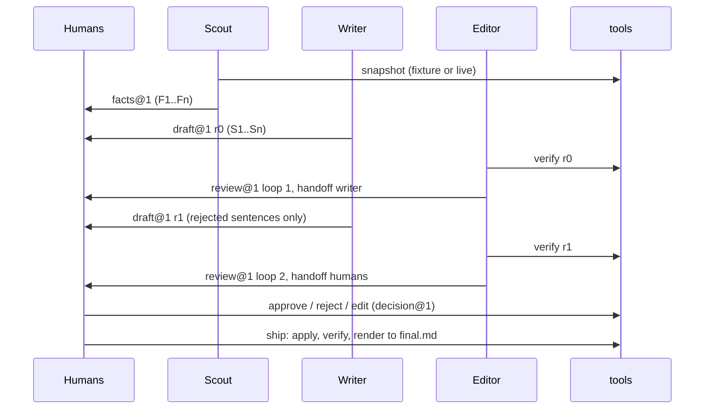

# CONTRACT.md

The interface every Switch Studio module builds against. **Owner: Vivek (M0). Only M0 edits this file and `schemas/`.** To propose a change, open an issue labelled `needs-triage`; M0 updates the contract, schemas, and examples in one PR. Rationale for each rule lives in the linked ADR, not here.

**Core rule:** no sentence survives unless it points to a fact that deterministic code can confirm against the repo.

---

## 1. Sources of truth

| What | Where |
|---|---|
| Exact JSON shapes | [`schemas/*.schema.json`](schemas/) |
| One worked example per shape (a single consistent 3-commit story) | [`schemas/examples/`](schemas/examples/) |
| Validator (stdlib only) | `python -m schemas.validate FILE…` / `--examples`; in code: `from schemas.validate import validate, load_document` |
| Python types | [`schemas/types.py`](schemas/types.py) (mirrors the JSON schemas) |
| Rules and semantics | this file |

Runtime: Python 3.11+, standard library only; `pytest` is the only dev dependency ([ADR-0002](docs/adr/0002-python-stdlib-only.md)).

---

## 2. Documents

Every `studio/*` document except `snapshot` and `grade` carries the envelope `schema`, `run_id` (`^[a-z0-9][a-z0-9-]{2,39}$`), `agent`, `created_at` (UTC, `YYYY-MM-DDTHH:MM:SSZ`).

| Schema | Produced by | Agent | Example |
|---|---|---|---|
| `studio/run@1` | infra (M1) | `tool` | [run.json](schemas/examples/run.json) |
| `studio/snapshot@1` | `tools.snapshot`; fixtures | n/a | [snapshot.json](schemas/examples/snapshot.json) |
| `studio/facts@1` | Scout | `scout` | [facts.json](schemas/examples/facts.json) |
| `studio/draft@1` | Writer, or a human edit | `writer` / `human` | [draft.r0.json](schemas/examples/draft.r0.json) |
| `studio/verdict@1` | `tools.verify` | `tool` | [verdict.r0.json](schemas/examples/verdict.r0.json) |
| `studio/review@1` | Editor | `editor` | [review.r0.json](schemas/examples/review.r0.json) |
| `studio/decision@1` | infra bot, from a human command | `human` | [decision.json](schemas/examples/decision.json) |
| `studio/grade@1` | `tools.grade` | `tool` | [grade.json](schemas/examples/grade.json) (numbers illustrative) |

### Room messages and overflow ([ADR-0007](docs/adr/0007-room-message-format.md))

Each agent message in `#studio` = a short human summary, then exactly one fenced ```` ```json ```` block holding one document. Parsers read only the JSON block.

When a document is too large, the block holds an **overflow envelope** instead: the envelope fields plus `payload_ref: {path, sha256}`, where `path` is under `runs/<run_id>/` and `sha256` is the hex digest of the file bytes. `load_document()` resolves it, checks the digest, and validates the payload.

### `runs/<run_id>/` (gitignored, never committed)

```
run.json  snapshot.json  facts.json
draft.r<N>.json  verdict.r<N>.json  review.r<N>.json
decisions.jsonl  final.md  grade.json
```

---

## 3. Snapshot rules ([ADR-0003](docs/adr/0003-local-git-snapshots.md))

- Source is a local `git clone`; never the network. One run = one revision `range` (default: last 50 commits). Snapshot, facts, verifier, and grader all use the same `range`.
- Fixtures in `/fixtures` are saved snapshots, so offline and live runs are indistinguishable downstream.
- Merge commits are excluded (`--no-merges`). Commits newest first. `hash` is full 40-hex.
- File `status` ∈ `A M D R`; for `R`, `path` is the new path. `added`/`deleted` are `null` for binary files and count as 0.
- Contributor identity = `author_email`.

---

## 4. Facts ([ADR-0004](docs/adr/0004-structured-facts-and-sentences.md), [ADR-0005](docs/adr/0005-deterministic-verification-rules.md))

IDs are `F1…Fn`, scoped to one `run_id`. **Every fact carries a full 40-hex `commit`**: the commit itself for `scope: "commit"` and non-count facts; `snapshot.head` for `scope: "run"`.

| `kind` | Fields | The verifier confirms |
|---|---|---|
| `commit` | `subject`, `author_name`, `date` | the commit exists in the snapshot and all three fields match exactly |
| `file` | `path`, `status` | `path` appears in that commit's `files` with that `status` |
| `count` | `metric`, `scope`, `value`, optional `author_email` | recomputing gives exactly `value` |

**Count metrics (closed list; anything else is `FACT_INVALID`):**

| `metric` | Allowed `scope` | `author_email` | Definition over the commits in scope |
|---|---|---|---|
| `commits` | `run` | allowed | number of commits |
| `files_changed` | `commit`, `run` | `run` only | number of distinct `path`s |
| `lines_added` | `commit`, `run` | `run` only | Σ `added` |
| `lines_deleted` | `commit`, `run` | `run` only | Σ `deleted` |
| `contributors` | `run` | never | number of distinct `author_email` |

`statement` is human display text. The verifier ignores it; it is never a source of numbers.

---

## 5. Drafts

- Sentences are `S1…Sn`. Citations live **only** in `facts[]`; `text` never contains `[F…]` tags. The renderer appends tags.
- A revision keeps sentence IDs and increments `revision`. The Writer changes only sentences the Editor rejected.

---

## 6. Sentence verification rules ([ADR-0005](docs/adr/0005-deterministic-verification-rules.md))

For each sentence, `tools.verify` applies these steps in order:

1. **Citation:** `facts[]` empty → `NO_CITATION`. An ID not in the facts doc → `UNKNOWN_FACT`. A cited fact that failed its own check → `FACT_INVALID`.
2. **Strip** before scanning `text`: `[F\d+]` tags; `\bS\d+\b` sentence IDs; ISO dates (`YYYY-MM-DD`, optional `THH:MM[:SS]Z`) whose date part equals the date of a **cited** commit.
3. **Hashes:** each token matching `\b[0-9a-f]{7,40}\b` that contains at least one letter `a–f` must be a prefix of a **cited** fact's `commit`, else `HASH_UNSUPPORTED`. Matched hashes are removed before step 4.
4. **Numbers:** each remaining number token not glued to a word, path, or version (no `[\w/.\-]` immediately before it; commas between thousands removed; optional decimal and `%`) must equal either
   - the `value` of a **cited** `count` fact, or
   - a number token in a **cited** fact's `subject` or `path` (e.g. `12` from `"(#12)"`),

   else `NUMBER_UNSUPPORTED`.

Consequences: `v0.1`, `S1`, `tools/verify2.py`, `[F2]` are never checked. Derived numbers (%, ratios, "2×") have no fact to match, so they fail. Number words ("three", "a dozen") are not checked; see `docs/NOT-BUILT-YET.md`.

**Verdict:** `pass` = every fact ok **and** every sentence under check ok. `summary` counts both. Verifier error codes are exactly: `NO_CITATION` `UNKNOWN_FACT` `FACT_INVALID` `NUMBER_UNSUPPORTED` `HASH_UNSUPPORTED`.

---

## 7. Editor ↔ Writer loop

1. The Editor runs `tools.verify` first and copies its errors per sentence, then may add one judgment code: **`OVERCLAIM`** (the text asserts more than its cited facts).
2. Any rejection and `loop` < 2 → `handoff: "writer"`; the Writer revises only rejected sentences, keeping their IDs.
3. After loop 2, or with nothing rejected → `handoff: "humans"`.
4. Agents never remove sentences.

---

## 8. Human commands ([ADR-0006](docs/adr/0006-human-commands-and-ship-gate.md))

Any one human's command is enough. The infra bot parses each command into a `decision@1` line appended to `runs/<run_id>/decisions.jsonl`; sentence state is derived by replaying that file (`tools.apply`). States: `pending` → `approved` | `rejected`.

| Command | Effect |
|---|---|
| `approve S3` | S3 → `approved` |
| `approve all` | every `pending` sentence → `approved` |
| `reject S3: <reason>` | S3 → `rejected`: **dropped from the final output**; reason recorded |
| `edit S3: <new text> [F2][F5]` | trailing tags become `facts[]`; new `draft@1` revision with `agent: "human"` is verified. Pass → S3 `approved`. Fail → refused (`EDIT_VERIFY_FAILED`); no tags → refused (`EDIT_NO_CITATION`) |
| `ship` | only when no sentence is `pending` **and** `tools.verify` passes on the non-rejected sentences; else `SHIP_BLOCKED`. Writes `runs/<run_id>/final.md`. **Nothing is ever posted anywhere.** |

Decision `result.error` codes: `UNKNOWN_SENTENCE` `EDIT_NO_CITATION` `EDIT_VERIFY_FAILED` `SHIP_BLOCKED` `PARSE_ERROR`.

### `final.md` format (`tools.render`)

```markdown
Saurabh shipped a claim verifier CLI in tools/verify.py. [F1][F2] That commit added 246 lines. [F3]

---
**Sources**
- F1: 9f3c2a1 Add claim verifier CLI (#12)
- F2: 9f3c2a1 tools/verify.py (A)
- F3: 9f3c2a1 lines_added (commit) = 246
```

---

## 9. Before/after grading (`tools.grade`)

Both inputs (the one-shot baseline and Switch Studio's `final.md`) are graded as plain markdown by the same rule:

1. Strip `[F\d+]` tags and the Sources footer.
2. Split sentences on `.` `!` `?` followed by whitespace or end of line. **The grader is the only code that splits prose heuristically.**
3. Without citations, a number is supported if it equals any metric value computable from the snapshot (any metric × any scope × any author), or a number token in any commit subject or path. A hash is supported if it prefixes any commit. Dates matching any commit date are ignored.
4. A sentence is **supported** only if it has at least one checkable claim and all of them are supported.

Output: `studio/grade@1` with per-input `sentences_total`, `sentences_supported`, `supported_pct` (one decimal), `claims_total`, `claims_supported`, `hashes_fabricated`, `numbers_unsupported`.

---

## 10. CLI surface

All tools: JSON to stdout (or `--out`), no network, never write to the analyzed repo, validate inputs with `schemas.validate`.

| Command | Does | Exit |
|---|---|---|
| `python -m tools.snapshot --repo PATH --range R --out FILE` | git → `snapshot@1` | 0 ok / 2 error |
| `python -m tools.verify --snapshot S --facts F --draft D [--out V]` | → `verdict@1` | 0 pass / 1 fail / 2 usage or schema error |
| `python -m tools.apply --draft D --decisions decisions.jsonl --out D2` | replay decisions → effective `draft@1` (non-rejected sentences) | 0 / 2 |
| `python -m tools.render --draft D --facts F --out final.md` | §8 markdown | 0 / 2 |
| `python -m tools.grade --snapshot S --input LABEL=PATH [--input …]` | → `grade@1` | 0 / 2 |
| `python -m schemas.validate FILE… \| --examples` | schema check | 0 valid / 2 invalid |

On exit 2, tools print `{"error": "...", "path": "..."}` to stderr.

---

## 11. Handoff sequence


