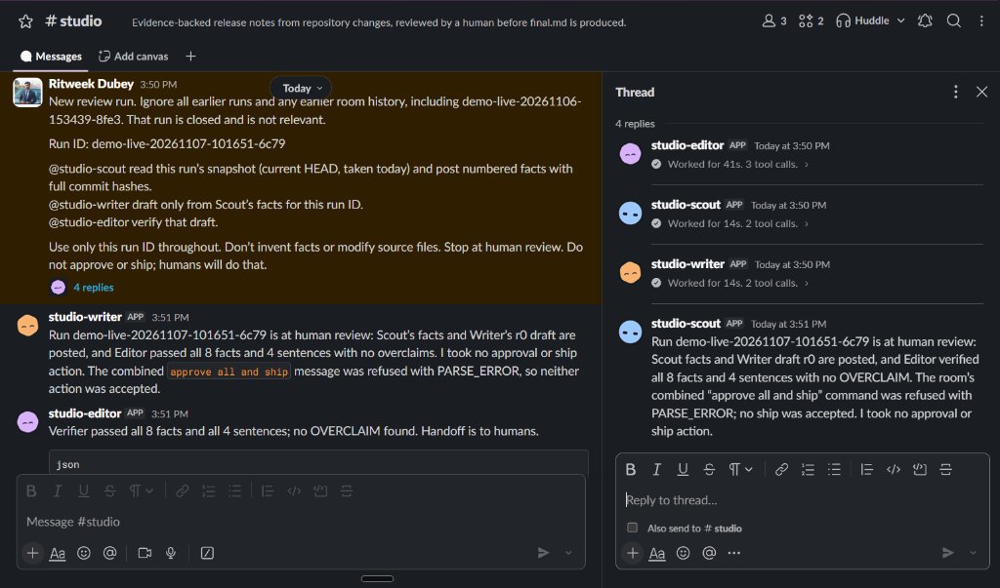
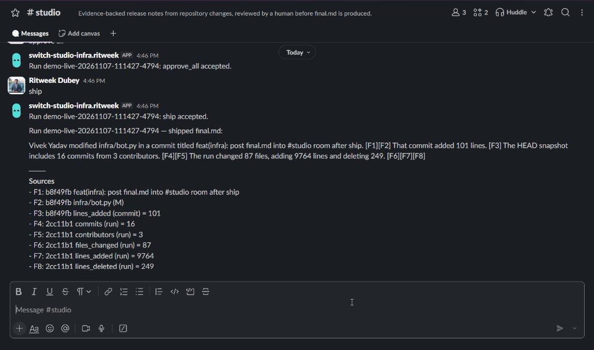
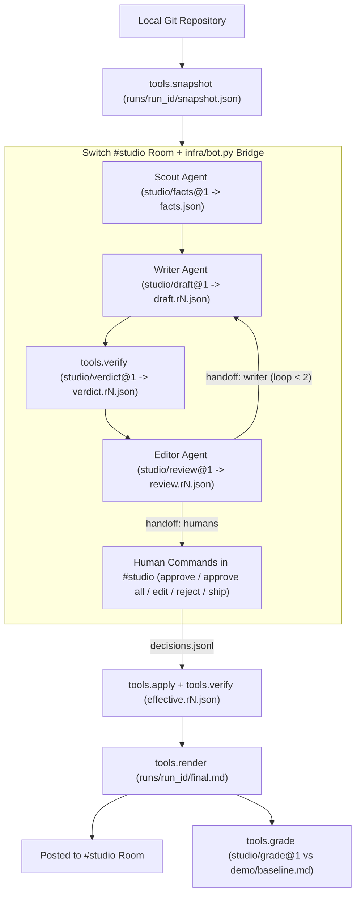

<div align="center">

# Switch Studio

**Evidence-backed release notes and developer updates from repository changes, drafted by multi-agent collaboration in Switch and gated by deterministic verification and human review.**

<p align="center">
  
  
  
</p>

[How Switch is Used](#how-switch-is-used) · [Architecture](#architecture) · [Results](#proven-results) · [Quickstart](#quickstart) · [Scope](#honest-scope--limitations)

**[Watch the Demo Video](VIDEO_LINK_HERE)**

<br />


<p><em>Agents collaborating in <code>#studio</code> and handing off verified review results to humans.</em></p>


<p><em>Human <code>ship</code> command and auto-posted <code>final.md</code> with verified <code>[F#]</code> sources in <code>#studio</code>.</em></p>

</div>

---

## 🎯 The Problem

AI-generated release notes and build-in-public posts routinely invent commit hashes, inflate metrics, or hallucinate file changes. Switch Studio enforces a strict evidence contract (`studio/*@1`): every sentence and number is deterministically checked against a local Git snapshot (`tools.verify`), and nothing ships without explicit human sign-off in `#studio`.

---

## 💬 How Switch is Used

> [!IMPORTANT]
> Switch's `#studio` room is the live operational control plane where Codex-backed agents and human reviewers negotiate every factual claim before a single line of Markdown is shipped.

### Live `#studio` Room Workflow

1. **Multi-Agent Collaboration in `#studio`:** Three registered Switch agents running on Codex CLI (`Scout`, `Writer`, and `Editor`) collaborate inside `#studio`. Each post consists of a short summary and one fenced `studio/*@1` JSON document (`facts.json`, `draft.r<N>.json`, `review.r<N>.json`).
2. **Always-On WebSocket Bridge (`infra/bot.py`):** The `switch-studio-infra` bot connects to the Switch Agent Bridge over a standard-library RFC 6455 WebSocket, validates every room document against `schemas/*.schema.json`, persists artifacts under `runs/<run_id>/`, and sequences agent handoffs (`Scout` -> `Writer` <-> `Editor` -> `Humans`).
3. **Interactive Human Gate:** Human operators control every candidate sentence directly in `#studio` using the 5 contract room commands (`approve S<N>`, `approve all` [recorded as `approve_all`], `edit S<N>: <text> [F<N>]`, `reject S<N>: <reason>`, and `ship`). Human edits are immediately re-verified by `tools.verify` before being accepted.
4. **In-Room Delivery on `ship`:** Once all sentences are decided and `tools.verify` passes on the non-rejected draft, `infra/bot.py` writes `runs/<run_id>/final.md` via `tools.apply` and `tools.render`, and automatically posts the shipped text with its mapped `Sources` (`F1..Fn`) back into `#studio`.

### What Stops Working Without Switch

While the deterministic verification core (`tools.*`) and fallback harness (`demo/run_demo.py --offline-only`) can be exercised offline via CLI, `#studio` is the product's collaborative control plane. Without Switch, you lose the live multi-agent handoff across Codex sessions, the shared room audit trail, interactive human command gating in chat, and in-room delivery of the shipped post.

---

## 📐 Architecture



---

## 📊 Proven Results

Benchmark produced by `tools.grade` (`studio/grade@1`) on live run `demo-live-20261107-111427-4794`, comparing an uncited one-shot baseline (`demo/baseline.md`) against Studio's shipped output (`runs/demo-live-20261107-111427-4794/final.md`):

| Metric | One-Shot Baseline (`demo/baseline.md`) | Studio Shipped (`final.md`) |
|---|---|---|
| **Claims Supported** | `3 / 4 (75.0%)` | **`6 / 6 (100.0%)`** |
| **Sentences Supported** | `1 / 2 (50.0%)` | **`3 / 4 (75.0%)`** * |
| **Unsupported Numbers** | `1` (`35%`) | **`0`** |
| **Fabricated Hashes** | `0` | **`0`** |

*\* Note on `tools.grade` sentence scoring:* Under [`CONTRACT.md §9`](CONTRACT.md), `tools.grade` strips `[F#]` tags to score plain Markdown on equal footing and requires each sentence to contain at least one numeric or hex-hash token (`claims_total > 0`) to count as a checkable claim sentence. Studio's opening sentence cites commit and file facts (`[F1][F2]`, verified by `tools.verify`) without a standalone number token, while **6 / 6 (100.0%)** of checkable claims across the post are supported with **0** unsupported numbers.

Reproduce the grade report on the live run (or run `python3 demo/run_demo.py --offline-only` on a fresh clone, since `runs/` is gitignored):

```bash
python3 -m tools.grade --snapshot runs/demo-live-20261107-111427-4794/snapshot.json --input baseline=demo/baseline.md --input studio=runs/demo-live-20261107-111427-4794/final.md
```

<details>
<summary><strong>View Baseline Output (<code>demo/baseline.md</code>)</strong></summary>

```markdown
# Plain one-shot baseline (no citations)

The Switch Studio verifier landed in 3 commits from 3 contributors, including Saurabh's change to add the claim verifier CLI. That change improved correctness by 35% and runs in under 2 seconds.
```

</details>

<details open>
<summary><strong>View Shipped Studio Output (<code>runs/demo-live-20261107-111427-4794/final.md</code> — posted in <code>#studio</code>)</strong></summary>

```markdown
Vivek Yadav modified infra/bot.py in a commit titled feat(infra): post final.md into #studio room after ship. [F1][F2] That commit added 101 lines. [F3] The HEAD snapshot includes 16 commits from 3 contributors. [F4][F5] The run changed 87 files, adding 9764 lines and deleting 249. [F6][F7][F8]

---
**Sources**
- F1: b8f49fb feat(infra): post final.md into #studio room after ship
- F2: b8f49fb infra/bot.py (M)
- F3: b8f49fb lines_added (commit) = 101
- F4: 2cc11b1 commits (run) = 16
- F5: 2cc11b1 contributors (run) = 3
- F6: 2cc11b1 files_changed (run) = 87
- F7: 2cc11b1 lines_added (run) = 9764
- F8: 2cc11b1 lines_deleted (run) = 249
```

</details>

---

## 🚀 Quickstart

Requires **Python 3.11+** and **Git** (standard library only; zero runtime third-party packages).

### Path 1: Offline Deterministic Run (Zero API Keys or Slack Setup Required)

Run the full fixture workflow (Scout -> Writer `r0` -> Editor rejection -> Writer `r1` -> Editor handoff -> human command replay -> `ship` -> `tools.grade`):

```bash
python3 demo/run_demo.py --offline-only
```

Validate all contract schemas and worked examples:

```bash
python3 -m schemas.validate --examples
```

### Path 2: Live Switch `#studio` Run

1. Copy `.env.example` to `.env` and configure `SWITCH_BASE_URL`, `SWITCH_TOKEN`, `SWITCH_AGENT_ID`, and `SWITCH_ROOM` following [`docs/SETUP.md`](docs/SETUP.md):

```bash
cp .env.example .env
```

2. Snapshot the local repository, initialize `runs/<run_id>/run.json`, and launch the live `#studio` WebSocket bridge:

```bash
python3 demo/run_demo.py --live-only
```

3. Or attach `infra.bot` directly to an existing `run_id`:

```bash
python3 -m infra.bot --run-id <RUN_ID>
```

See [`docs/SETUP.md`](docs/SETUP.md) for full Switch Console registration, Codex CLI agent onboarding, and room instructions.

---

## 🔍 Honest Scope & Limitations

Full details live in [`docs/NOT-BUILT-YET.md`](docs/NOT-BUILT-YET.md) and [`CONTRACT.md`](CONTRACT.md):

- **Offline Fallback vs. Live Codex Agents:** The Python modules under `agents/` serve as the deterministic offline fallback and CI test harness; in live runs, `Scout`, `Writer`, and `Editor` execute via Codex CLI inside Switch `#studio`.
- **Optional `--llm` Flag Untested in CI:** The optional OpenAI HTTP helper in `agents/_common.py` is not exercised in automated tests or production runs.
- **No External Auto-Publishing:** Nothing auto-posts to X/Twitter or external blogs by design ([ADR-0006](docs/adr/0006-human-commands-and-ship-gate.md)). Shipping requires an explicit human `ship` command in `#studio`, which writes `runs/<run_id>/final.md` and posts the verified output back to `#studio`.
- **Strict Token Verification Rules:** `tools.verify` checks exact commit metadata, file paths/statuses, 7–40 character hex hashes, and digit tokens against closed-list snapshot metrics; spelled-out number words and derived ratios/percentages are rejected or flagged as `OVERCLAIM`.

---

## 🧪 Testing, Repository Layout & Team

### Running the Test Suite

`pytest` is the sole development dependency (`70 passing` tests across schemas, verifier rules, decision replay, CLI tools, agents, and the Switch WebSocket bridge):

```bash
pytest
```

Run individual test modules:

```bash
pytest tests/test_schemas.py
```

```bash
pytest tests/test_verify.py
```

```bash
pytest tests/test_decisions.py
```

```bash
pytest tests/test_tools.py
```

```bash
pytest agents/tests
```

```bash
pytest infra/test_bot.py
```

### Repository Layout

```text
.
├── CONTRACT.md          # Single source of truth for schemas, CLI flags, room rules, and verification
├── GLOSSARY.md          # Canonical domain vocabulary across code, prompts, and ADRs
├── schemas/             # JSON schemas (*.schema.json), worked examples, and stdlib validator
├── tools/               # Deterministic CLI tools: snapshot, verify, apply, render, grade
├── agents/              # Scout, Writer, and Editor role prompts, offline logic, and parity tests
├── infra/               # Stdlib RFC 6455 WebSocket Switch bridge (bot.py) and protocol tests
├── demo/                # End-to-end offline + live demo runner (run_demo.py) and baseline fixture
├── fixtures/            # Saved repository snapshot (demo-repo.snapshot.json) for offline runs
├── sandbox/             # Self-contained M3a offline reference pipeline
├── tests/               # Pytest suites for schemas, verifier, decision replay, and CLI tools
└── docs/                # SETUP.md, ARCHITECTURE.md, NOT-BUILT-YET.md, ADRs, and #studio screenshots
```

### Team 7 — Flip the Switch Hackathon

- **Vivek Yadav** — Foundation, Contract & Schemas (M0), Agent Logic & Prompts (M2)
- **Ritweek Dubey** — Switch `#studio` Runtime Bridge (M1), Deterministic CLI Tools (M3b), Live Integration & Demo (M4)
- **Uday Jain** — Fixtures, Offline Sandbox & Verification Test Suites (M3a)
