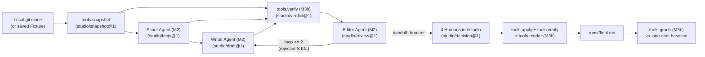

# Architecture

Switch Studio turns repository commit history into a `#HowISwitch` post or blog section where every surviving sentence cites a verifiable fact checked by deterministic code.

For exact JSON schemas, CLI flags, and verification rules, see [`CONTRACT.md`](../CONTRACT.md). For domain terms, see [`GLOSSARY.md`](../GLOSSARY.md).

---

## System Overview

---

## Modules & Boundaries

| Module | Owner | Path | Responsibility |
|---|---|---|---|
| **M0 Foundation** | Vivek (`@waynevivek`) | `/`, `/schemas/`, `/docs/` | Contract (`CONTRACT.md`), JSON schemas + stdlib validator (`schemas/`), ADRs (`docs/adr/`), glossary. |
| **M1 Switch Runtime** | Ritweek (`@Ritweek17`) | `/infra/`, `docs/SETUP.md` | Switch `#studio` room setup, agent registration, **infra bot** that parses room messages/commands and bridges `runs/<run_id>/`. |
| **M2 Agent Logic** | Vivek (`@waynevivek`) | `/agents/<name>/` | Prompts, role rules, and handoff wrappers for `scout`, `writer`, and `editor`. |
| **M3a Fixtures, Sandbox & Tests** | Uday (`@udayjain06`) | `/fixtures/`, `/sandbox/`, `/tests/`, `docs/NOT-BUILT-YET.md` | Saved snapshot fixtures, offline agent runner (`sandbox/`), and `pytest` suite verifying tools, schemas, and agent outputs without Switch running. |
| **M3b Deterministic Tools** | Saurabh | `/tools/` | Offline, read-only Python 3.11+ stdlib CLIs: `snapshot`, `verify`, `apply`, `render`, and `grade`. |
| **M4 Integration & Demo** | Ritweek (`@Ritweek17`) | `/demo/` | End-to-end demo script, baseline one-shot prompt capture, and before/after grading showcase. |

---

## Data Flow of a Run

Every run is scoped to a `run_id` and writes its artifacts to `runs/<run_id>/` (gitignored):

1. **Run init (`studio/run@1`):** Infra (or sandbox) records the `mode` (`fixture` or `live`), `repo_path`, revision `range`, and target `format` (`howiswitch` or `blog_section`).
2. **Snapshot (`studio/snapshot@1`):** In `fixture` mode, copied from `/fixtures/`. In `live` mode, `python -m tools.snapshot` inspects the local git clone over `range` (`--no-merges`).
3. **Scout (`studio/facts@1`):** Reads the snapshot and posts numbered facts `F1…Fn` (`commit`, `file`, `count`) to `#studio`. Every fact carries a full 40-char commit hash.
4. **Writer (`studio/draft@1`):** Drafts sentences `S1…Sn` using only `F1…Fn` in each sentence's `facts[]`.
5. **Verifier (`studio/verdict@1`):** `python -m tools.verify` deterministically recounts every `count` fact, checks every `commit` and `file` fact against the snapshot, and checks every sentence for citations, supported numbers, and supported hashes.
6. **Editor (`studio/review@1`):** Runs `tools.verify` first, copies any deterministic errors, and optionally adds `OVERCLAIM` where prose states more than its cited facts. Hands back to Writer for up to 2 revision loops, then hands off to `humans`.
7. **Human gate (`studio/decision@1`):** Humans in `#studio` issue `approve`, `approve all`, `reject`, `edit`, and `ship`. Each command is appended to `decisions.jsonl`.
8. **Ship (`final.md`):** On `ship`, `tools.apply` replays decisions (dropping rejected sentences and applying verified human edits), `tools.verify` re-confirms the surviving draft passes, and `tools.render` outputs `runs/<run_id>/final.md` with inline `[Fn]` citations and a `Sources` footer.
9. **Before/After Grade (`studio/grade@1`):** `tools.grade` scores both the one-shot `baseline.md` and Switch Studio's `final.md` against the snapshot using identical rules.
